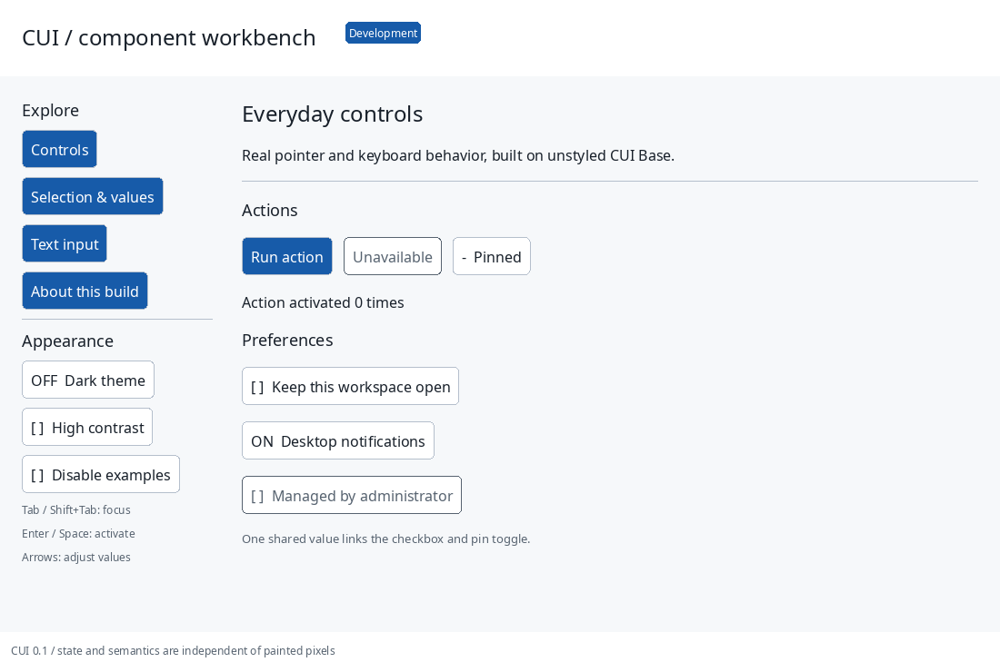

# CUI

An experimental C11 native UI framework: Clay layout, unstyled interaction primitives, themed controls, and independent renderer adapters. Embed it in an existing host or run the SDL3 workbench. No browser engine, JavaScript VM, Rust runtime, or platform types in the public core API.

**Development snapshot, not production-ready or full GPUI Kit parity.** The complete78-family target is tracked in [the feature manifest](docs/gpui-parity.json). Working partial controls include buttons, checked/pressed selection, sliders and a UTF-8 scalar Input preview. Core focus/capture, semantic snapshots, bounded undo/redo, modal scopes, popup reducers, Gregorian geometry and keyed variable-height virtualization and a retained docking tree have behavioral tests. Native accessibility bridges, complete text editing/IME/bidi/fallback, full compound widgets and other platform runtimes remain pending.



## Build and run

```sh
cmake -S . -B build -G Ninja
cmake --build build
ctest --test-dir build --output-on-failure
./build/cui_gallery
./build/cui_gpu_demo --font /path/to/font.ttf
```

Core/software need a C11 compiler and CMake; Python3 checks generated headers and the manifest. Native examples optionally discover SDL3 >=3.2, FreeType and HarfBuzz through pkg-config. Set `CUI_FONT` or `--font` for an explicit font. Missing native dependencies leave portable targets available; they do not create a fake native gallery.

```sh
cmake --preset headless && cmake --build --preset headless && ctest --preset headless
cmake --preset sanitize && cmake --build --preset sanitize && ctest --preset sanitize
./build/cui_gallery --headless --section text --dark --screenshot build/text.ppm
./build/cui_gallery --smoke 3 --screenshot build/native.bmp
```

The SDL_Renderer compatibility adapter reports its actual renderer name. The separate SDL_GPU implementation uses a borrowed device/window, SPIR-V/Vulkan shaders, antialiased geometry and a bounded glyph atlas. It has been exercised on Linux Xorg with an Intel Graphics device reported by SDL. Metal/D3D shader formats remain pending; SDL_GPU backend selection alone does not establish hardware acceleration. GPU tests register only with `-DCUI_GPU_TESTS=ON`, requiring an actual device/window. The independent Sokol GLCORE adapter borrows a host OpenGL context and framebuffer and has actual pixel/cache tests on the same Intel/Mesa device; see [its contract](backends/sokol/README.md). It has no SDL dependency.

## A small application

```c
#include "cui/cui_components.h"

void settings_frame(cui_context *ui, bool *notifications) {
    cui_theme theme = cui_theme_light();
    cui_begin_frame(ui, 640, 480, 1.0f / 60);
    cui_begin_box(ui, cui_id_from(ui, "settings"), (cui_box){
        .width = -1, .height = -1, .padding = 24, .gap = 12,
        .background = theme.background
    });
    cui_label(ui, &theme, cui_string("Settings"));
    cui_switch(ui, cui_id_from(ui, "notifications"), &theme,
               cui_string("Notifications"), notifications, false);
    cui_end_box(ui);
    cui_draw_list list = cui_end_frame(ui);
    /* Consume list synchronously using your renderer before the next frame. */
    (void)list;
}
```

Create/destroy the context in the host; queue input before begin. Width/height0 fit, negative grow, positive fix logical pixels. Stable scoped keys retain identity when lists reorder. Strings are copied to a bounded frame arena; returned draw/semantic pointers expire at the next begin. Read [API ownership](docs/API.md) and [the core contract](docs/CORE.md).

## Header-only distribution

`dist/` is reproducibly generated from modular sources and includes pinned Clay. In one C translation unit:

```c
#define CUI_IMPLEMENTATION
#include "cui.h"
#define CUI_BASE_IMPLEMENTATION
#include "cui_base.h"
#define CUI_COMPONENTS_IMPLEMENTATION
#include "cui_components.h"
```

Other translation units include those headers without implementation macros. Base includes the editor implementation; styled components include theme implementation. Optional overlay, virtual and dock models have their own implementation macros. Single-TU and multi-TU executables are tested. Conventional static library targets use `include/cui/`. C++ and Zig host examples are in [examples/embedding](examples/embedding).

`python scripts/amalgamate.py` regenerates; `make dist-check` checks exact reproducibility. `python tools/component_vendor/vendor.py /empty/destination --layer components` copies the layer dependency closure and licenses. This currently vendors all implemented controls in that layer; per-component source slicing is pending. No CLI is required to consume the library.

## Validation and scope

`make check lint format-check dist-check`, `make bench`, and `make gallery` are available. Tests cover previous-frame ordered routing, nested capture/clips/focus scopes, Unicode scalar editing and history, randomized keyed virtualization, independent semantics, software pixels, shaped text, SDL cache/clipboard services, actual GPU readback, embedding, and gallery bounds. [Platform matrix](docs/PLATFORM_MATRIX.md) distinguishes runtime evidence from authored CI. Windows/macOS CI jobs are configured; their results are recorded when run.

Read [the nightly report](docs/NIGHTLY_REPORT.md), [full component reference](docs/COMPONENTS.md), [architecture](docs/ARCHITECTURE.md), [component authoring](docs/COMPONENT_AUTHORING.md), and [remaining maintainer actions](docs/MAINTAINER_ACTIONS.md). All performance figures include workload context in [PERFORMANCE.md](docs/PERFORMANCE.md); none compare to other frameworks.

Original CUI source is MIT. Vendored Clay and Sokol are zlib-licensed. GPUI Kit0.7.1 is a pinned functional reference, not linked or copied into the C runtime; see [upstream baseline](docs/upstream-baseline.md) and [dependency inventory](third_party/dependencies.json).
