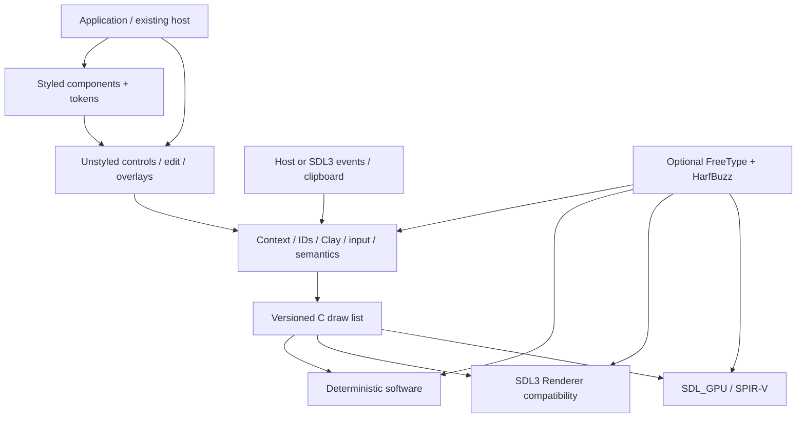

# Architecture

CUI is an experimental C11 framework with an explicit context and Clay layout adapter. `cui.h` has no SDL, OS, GPU or raw Clay API types. `cui_base.h`, editing and overlay models provide behavior; `cui_components.h` adds theme-driven painting. Platform and renderer interfaces are independent of widgets. Optional adapters are compiled integrations.

The SDL_GPU adapter borrows an existing GPU device and claimed window. It owns its pipeline, offscreen target, glyph atlas and transfer buffer. Window input remains host responsibility. Its initial shaders are SPIR-V/Vulkan; Metal/D3D shader builds remain pending. The SDL_Renderer adapter supplies the convenience window/event loop and caches bounded glyph textures. The software renderer accepts the same command stream without a GPU.

Contexts own fixed-budget Clay memory, commands, copied frame strings, semantics and prior hit regions. UI operations are confined to one thread; switching between contexts is supported, simultaneous thread access is not. Draw-list and semantic strings expire at the next begin frame. A text editor owns bounded scratch/history while its text buffer belongs to the application. Heavy models expose explicit handles.

Events queue before begin and dispatch in order against the previous completed layout. The initial frame establishes hit regions. Core focus scopes keep modal events inside the prior top scope, route dismissal to its reducer, and restore an enabled submitted trigger. Current composition then consumes activation and builds the next semantic and paint snapshots. Native widgets and semantic adapters remain future work.

Single-TU distribution is generated from modular source; the same source compiles into a static library. Third-party source stays pinned and attributed. No JavaScript or Rust runtime is required. All 78 families remain in the status manifest; tested partial APIs are not full family verification.
