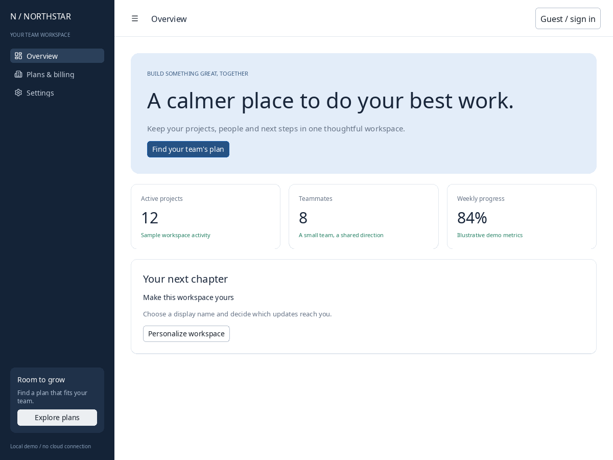
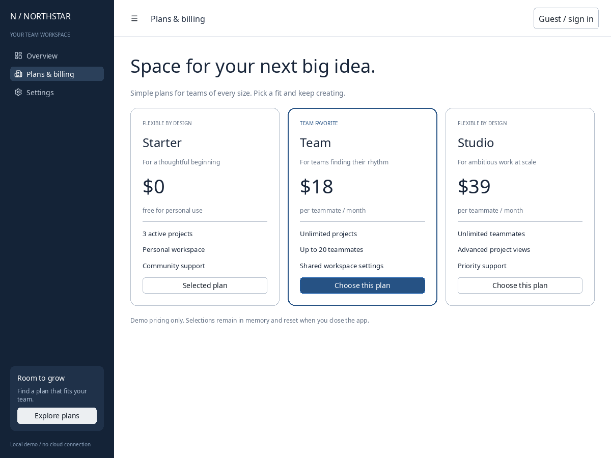
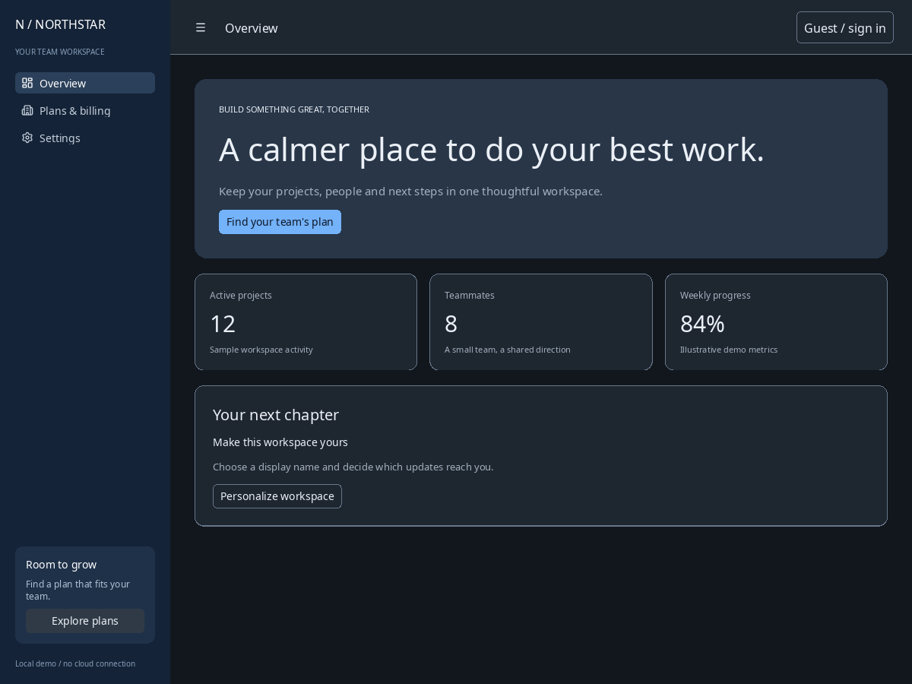
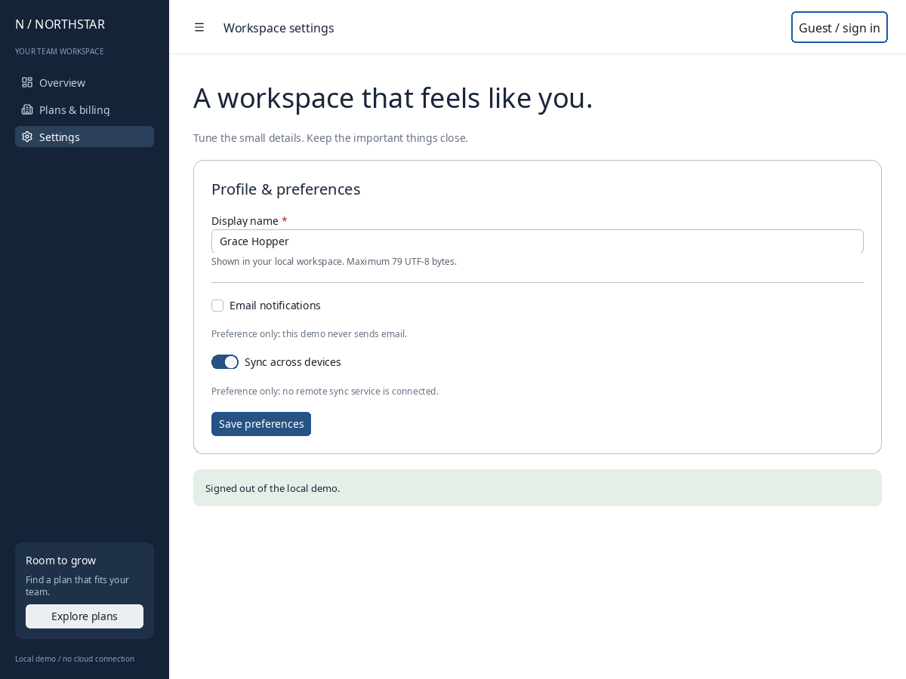

# Northstar: a composed native CUI application

Northstar is a complete, editable workspace demo assembled from real CUI
controls. Its overview, pricing and settings pages share a responsive navigation
shell and an account menu. It demonstrates application composition rather than
individual controls in isolation.



## Build and run

From the repository root:

```sh
cmake -S examples/composed_apps -B examples/composed_apps/build -G Ninja
cmake --build examples/composed_apps/build
ctest --test-dir examples/composed_apps/build --output-on-failure
```

The standalone project includes the checkout's CUI library, native adapters and
full repository test suite, then builds the `northstar` host and the additional
`composed_app_interactions` test. C11 sources compile with the repository's
warnings-as-errors settings. Requirements are CMake 3.20+, Ninja and a C/C++
compiler; the existing optional adapters use installed SDL3 3.2+, FreeType and
HarfBuzz. No new dependencies or downloads are introduced. The repository's
pinned optional SDL3 fetch remains available via `-DCUI_FETCH_SDL=ON`.

Choose an existing font file and launch the native application:

```sh
FONT=/usr/share/fonts/noto/NotoSans-Regular.ttf
examples/composed_apps/build/northstar --font "$FONT"
examples/composed_apps/build/northstar --font "$FONT" --page pricing
examples/composed_apps/build/northstar --font "$FONT" --page settings --width 390 --height 844
```

The font shown above was available on the Linux validation machine. Substitute
a real TrueType/OpenType file on your system. Native mode returns an error if
the adapter or font is unavailable; it does not silently become a headless demo.

For the portable core without native dependencies:

```sh
cmake -S examples/composed_apps -B examples/composed_apps/build-headless -G Ninja -DCUI_BUILD_NATIVE=OFF
cmake --build examples/composed_apps/build-headless --target northstar test_composed_app
examples/composed_apps/build-headless/test_composed_app
examples/composed_apps/build-headless/northstar --headless --page overview
examples/composed_apps/build-headless/northstar --headless --page pricing --width 390 --height 844
```

Headless mode builds actual CUI layout/render commands. The separate interaction
test drives actual pointer, keyboard, text and scroll events and asserts
application state. Headless execution does not open or validate a native window.

## What works

- **Navigation:** a real CUI sidebar menu switches Overview, Plans & billing and
  Settings. The hamburger hides/restores the desktop sidebar. Below 760 logical
  pixels, navigation starts hidden and the hamburger reveals it below the header;
  selecting a page closes it. It is an inline panel, not an overlay drawer.
- **Account:** the real account popup offers workspace settings and a local demo
  sign-in/sign-out command. Its desktop label reflects the saved display name; narrow layouts use a compact Account label. Popup
  dismissal and keyboard navigation come from CUI.
- **Overview:** a hero CTA opens pricing, metric cards stack on narrow content,
  and Personalize workspace opens settings. Metrics are explicitly sample data.
- **Pricing:** three cards show Starter, Team and Studio. Selecting a plan changes
  state, updates the selected CTA, displays confirmation and dispatches a callback.
  Re-selecting the current plan does not dispatch another change. Cards stack
  when content width is below 720 logical pixels.
- **Settings:** a CUI form associates the required name with a real text editor;
  checkbox and switch retain preferences. Save rejects an empty or ASCII
  whitespace-only name, stores the accepted name in session state and dispatches
  a save callback. Invalid saves leave the previous saved name intact.
- **Scrolling:** CUI scrollable content keeps stacked cards and forms reachable.
  Tracks hide when the authored page extent fits the current viewport.



## Copy the scene into your own host

The [scene header](../examples/composed_apps/app.h) contains only public CUI and
standard C types. SDL and font adapters live in [main.c](../examples/composed_apps/main.c).
[app.c](../examples/composed_apps/app.c) owns the application state and composition:

```c
#include "app.h"

static void changed(void *user, app_event event, app_snapshot state) {
    (void)user;
    if (event == APP_PLAN_CHANGED) {
        /* Dispatch your application's plan workflow using state.plan. */
    }
    if (event == APP_SETTINGS_SAVED) {
        /* Persist state.saved_name, state.notifications and state.sync. */
    }
}

composed_app *app = composed_app_create(changed, NULL);
/* Check app and your cui_context allocation before continuing. */
cui_begin_frame(ui, width, height, dt);
composed_app_scene(ui, app, width, height);
cui_draw_list commands = cui_end_frame(ui);
/* Render commands now, before another frame or app destruction. */
```

`composed_app_frame` combines begin, scene submission and end for a standalone
host. Use `composed_app_scene` when embedding into your own frame or gallery.
It builds a full-window shell using the width/height supplied by the host;
provide a context viewport matching that shell. Stable `APP_*` control IDs in
the header support testing and automation. Use one instance per context: the
IDs are intentionally fixed rather than namespaced for multiple side-by-side
instances in the same context.

Callbacks run synchronously during control submission on the UI thread. They
receive a read-only snapshot; its strings borrow application storage and can
change on the next interaction. Copy strings before retaining them. Do not
recursively submit a frame or destroy the app/context from a callback. Destroy
the app with `composed_app_destroy` after the renderer has consumed its last
draw list. The host owns CUI context, font and backend destruction separately.

To follow a host application's selected theme, copy its theme into the scene
before submitting the frame:

```c
cui_theme selected = cui_theme_dark();
composed_app_set_theme(app, &selected);
/* selected may now go out of scope: color/metric values were copied. */
composed_app_scene(ui, app, width, height);
```

Call the setter between frames on the UI thread. Calling it every frame is
supported; it preserves the selected plan, editor/preferences, session and
keyboard focus. `composed_app_set_theme(app, NULL)` restores Northstar's default
native palette. Pointer-valued icon hooks and their user storage remain owned by
the host and must retain the lifetimes required by CUI; copying the theme does
not copy data behind those pointers.

Cards and the header use `theme.surface`, the document uses `theme.background`,
and scene ink, borders and controls follow the supplied theme. The hero and
feedback panels derive subtle tints from its palette. The navy navigation rail
intentionally keeps its own readable light ink across themes. Light, dark,
high-contrast and terminal themes run through the complete interaction test;
representative header/hero/card ink contrast, keyboard focus paint, copied-theme
storage and live theme switching are also checked. These are targeted checks,
not a claim of a comprehensive accessibility audit.



To restyle the demo further, edit the `sidebar` composition and page render
functions. To connect it to production data, replace the sample metrics and
implement authentication, billing and persistence in your application layer.
The sample callback is the integration boundary.

## Native captures and interaction validation

Linux/X11 native captures were inspected for all three pages at 1200×900 and
390×844. The screenshots in this folder were produced by the actual SDL3 host,
not a browser recreation. A bounded native capture is reproducible:

```sh
FONT=/usr/share/fonts/noto/NotoSans-Regular.ttf
TMPDIR=/your/writable/cache timeout 15 xvfb-run -a -s '-screen 0 1600x1200x24' \
  examples/composed_apps/build/northstar --font "$FONT" --page pricing \
  --frames 3 --capture examples/composed_apps/build/pricing.bmp
```

Set `TMPDIR` to an existing writable directory when `/tmp` space is constrained.
Omit `TMPDIR=...` when your default temporary directory has sufficient space.
Capture requires a positive `--frames` count and a native backend. It writes the
last bounded frame to BMP; zero frames runs interactively until window close.

The native interaction check uses xdotool to choose Team, sign in through the
account menu, navigate to Settings, type Grace Hopper, change both preferences,
save and sign out. It asserts the resulting callback log and saves the final
native frame:

```sh
TMPDIR=/your/writable/cache timeout 20 xvfb-run -a -s '-screen 0 1600x1200x24' \
  examples/composed_apps/native-check.sh "$FONT"
```

The explicit Xvfb screen size matters: the default 1024×768 display would clamp
pointer coordinates for a 1200×900 application window. The check rejects a
display smaller than the window. Its fixed coordinates are specific to this
scene and the validated font; adapt them if changing layout/font metrics.
Artifacts appear in `build/native-interactions.log` and
`build/native-interactions.bmp`.



### Reproduce native host-theme validation

The optional native audit driver lives in `test_app.c` behind
`APP_THEME_NATIVE`; ordinary CTest stays portable. Build it explicitly after the
native example build above:

```sh
EXAMPLES=examples/composed_apps
cc -std=c11 -Wall -Wextra -Wpedantic -Werror -DAPP_THEME_NATIVE \
  -Iinclude -I"$EXAMPLES" "$EXAMPLES/app.c" "$EXAMPLES/test_app.c" \
  "$EXAMPLES/build/cui-build/libcui_sdl3.a" \
  "$EXAMPLES/build/cui-build/libcui_text.a" "$EXAMPLES/build/cui-build/libcui.a" \
  $(pkg-config --cflags --libs sdl3 freetype2 harfbuzz) -lm \
  -o "$EXAMPLES/build/test_theme_native"
```

The driver accepts `--native FONT light|dark|contrast|terminal OUTPUT_DIRECTORY`.
It runs a bounded 1200-frame window that closes after the verified workflow
settles, captures each visited page and its final
frame, prints measured control centers for automation, and returns success only
if the native interactions produced Team selection, sign-in/out and one saved
Grace Hopper profile with notifications off and sync on. The following helper
uses the measured centers rather than fixed per-theme coordinates:

```sh
cat > "$EXAMPLES/build/theme-check.sh" <<'SH'
#!/bin/sh
set -eu
font=$1
theme=$2
example_dir=$(pwd)/examples/composed_apps
"$example_dir/build/test_theme_native" --native "$font" "$theme" "$example_dir/build" \
  >"$example_dir/build/$theme-theme.log" 2>&1 &
client=$!
sleep 0.8
window=$(xdotool search --name '^Northstar / theme audit$')
xdotool windowfocus "$window"
click() {
  line=$(rg "^bound id=$1 " "$example_dir/build/$theme-theme.log" | tail -1)
  x=$(printf '%s\n' "$line" | awk '{sub("x=","",$3); print $3}')
  y=$(printf '%s\n' "$line" | awk '{sub("y=","",$4); print $4}')
  xdotool mousemove --window "$window" "$x" "$y" click 1
  sleep 0.6
}
click 120 # Overview CTA opens pricing.
click 131 # Choose Team.
click 101
xdotool key --window "$window" End Return # Sign in.
sleep 0.6
click 112 # Settings navigation.
click 140
xdotool key --window "$window" ctrl+a
xdotool type --window "$window" --clearmodifiers --delay 5 'Grace Hopper'
sleep 0.6
click 141
click 142
click 143
click 101
xdotool key --window "$window" End Return # Sign out.
wait "$client"
rg '^native event=' "$example_dir/build/$theme-theme.log"
SH
for theme in light dark contrast terminal; do
  timeout 30 xvfb-run -a -s '-screen 0 1600x1200x24' \
    sh "$EXAMPLES/build/theme-check.sh" "$FONT" "$theme" || break
done
```

Run from the repository root and set `TMPDIR` if needed as described above.
The helper assumes the validated font and Linux tools. It waits briefly for
window creation and bounded frame progress; slower machines may need longer
waits/timeouts. Each theme writes `<theme>-overview.bmp`, `<theme>-pricing.bmp`,
`<theme>-settings.bmp`, `<theme>-settings-saved.bmp` and `<theme>-theme.log` in the
build directory. Actual native workflows passed for all four themes; committed
light/dark PNGs show the captured SDL frames.

## Scope and limits

The scene's state is local and in memory. Demo sign-in does not authenticate,
plan selection creates no subscription or payment, and save does not write a
file or server. Notification/sync toggles record preferences without performing
those services. Closing the app resets its state. Prices and activity metrics
are illustrative, not an external product offer or telemetry feed.

Native operation and actual interaction were validated on Linux with SDL3
3.4.18, FreeType/HarfBuzz and Noto Sans under Xvfb. Physical displays, Wayland,
Windows and macOS have not been validated by this example. It uses CUI controls
painted into an SDL desktop window, not operating-system-native widgets.
Regular font shaping works; additional bold/italic font faces can be registered
by an embedding host for stronger typography. No claim of complete component
or platform parity is implied.

Page scroll extents are explicit scene estimates, chosen for this sample's
content and responsive breakpoints. Update those estimates alongside page
content or font changes; they are not an automatic document measurement system.
Name validation only rejects empty/ASCII-whitespace-only names and the editor
limits storage to 79 UTF-8 bytes; it is not a full identity validation policy.
