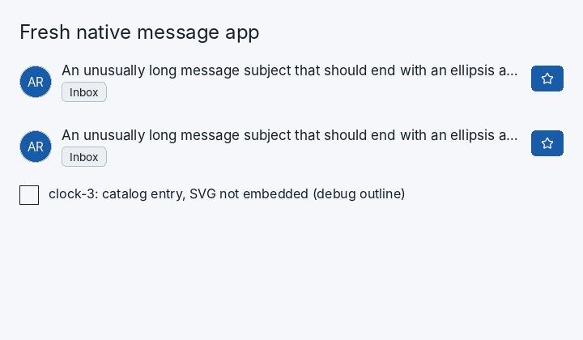

# Layout and custom content

Use `include/cui/cui.h` as the exact field/signature authority. This guide is the
canonical introduction; [Core](CORE.md) records advanced contracts. Dimensions
are logical pixels. A box is a column unless `.row = true`.

| Intent | `cui_box` fields | Effect |
| --- | --- | --- |
| FIT | `.width = 0` | Natural content width; the default |
| Grow | `.width = -1` | Share available parent space |
| Fixed | `.width = 120` | Request 120 pixels |
| Exactly zero | `.width = 0, .fixed_width = true` | Collapsed width |
| Maximum | `.max_width = 320` | Cap FIT, grow or fixed width |
| Clip | `.clip = true` | Clip child paint and hit regions to the box |

The same rules apply to height and its corresponding fields. Positive finite
maximums constrain even fixed minimums; other maximums are unbounded. A maximum
is a cap, not a request to grow. Give an ancestor a constrained width before
expecting descendants to wrap. Padding and gaps consume available space.
`align_x` and `align_y` use physical axes; centering needs unused space.

```c
cui_begin_box(ui, cui_id_from(ui, "message"),
    (cui_box){.width = -1, .max_width = 480, .padding = 12,
              .gap = 8, .clip = true});
cui_text(ui, cui_string("A paragraph that may wrap within this card."),
         16, (cui_color){30, 30, 30, 255});
cui_end_box(ui);
```

`cui_text`/`cui_text_ex` use normal layout wrapping. `cui_text_line` preserves an
unwrapped line; put it inside a clipping ancestor if overflow must be hidden.
`cui_text_paragraph_colored` explicitly selects word wrapping with its `wrap`
argument and supports hard paragraphs. Clipping alone does not insert an
ellipsis or reflow text. Font registration must precede measurement/layout.

Compose arbitrary content with boxes and public leaf/component calls. A
convenience component that takes a label does not automatically accept arbitrary
children. For a custom card or mail row, compose the surface yourself rather than
inventing a component content callback. Balance every `cui_begin_box` with
`cui_end_box`, including skipped/capacity-failed boxes; APIs returning a boolean
begin result have their own documented successful-begin balancing rule.

For a mail row, use a growing row with a fixed avatar, a growing text column and
a fixed trailing timestamp. Constrain the text column, clip long single-line
subjects, and wrap the preview only when its row height may grow. Do not size a
whole row from last frame's measured width: resize should resolve in this frame.
See [IDs and lifetimes](IDS_AND_LIFETIMES.md) before repeating the row.

## Single-line ellipsis with fixed trailing controls

Use `cui_text_ellipsis` from `include/cui/cui_text_overflow.h` when a single-line
subject must shorten visibly. It resolves width in the current frame, preserves
extended grapheme boundaries, and keeps the full text as its semantic name.
Unlike clipping, it paints a trailing ellipsis when enough space remains.

```c
cui_begin_box(ui, cui_id_from(ui, "mail-row"),
    (cui_box){.width = -1, .row = true, .gap = 8});
cui_text_ellipsis(ui, cui_id_from(ui, "subject"), subject,
    (cui_text_ellipsis_options){.width = -1, .font_size = 16,
                              .color = theme->text});
cui_begin_box(ui, cui_id_from(ui, "star-slot"),
    (cui_box){.width = 32, .height = 32, .fixed_width = true});
/* Submit a star button/icon with another unique ID here. */
cui_end_box(ui);
cui_end_box(ui);
```

Constrain an ancestor's width. A positive helper width is fixed; negative grows;
zero is invalid. Height uses natural font metrics. Newlines are rejected, and
prefix/ellipsis are shaped separately. The helper does not provide paragraph
reflow, font fallback, or contextual shaping across the ellipsis boundary.
Check its boolean result and the context diagnostic after submission. Give each
repeated row a persistent ID scope as described in [IDs and lifetimes](IDS_AND_LIFETIMES.md).



A real SDL3 software capture of an external application using these APIs.
The [evaluation record](validation/developer-usability-agent.md) contains its
source and observed limits; it is a correctness smoke test, not a blind usability study.
