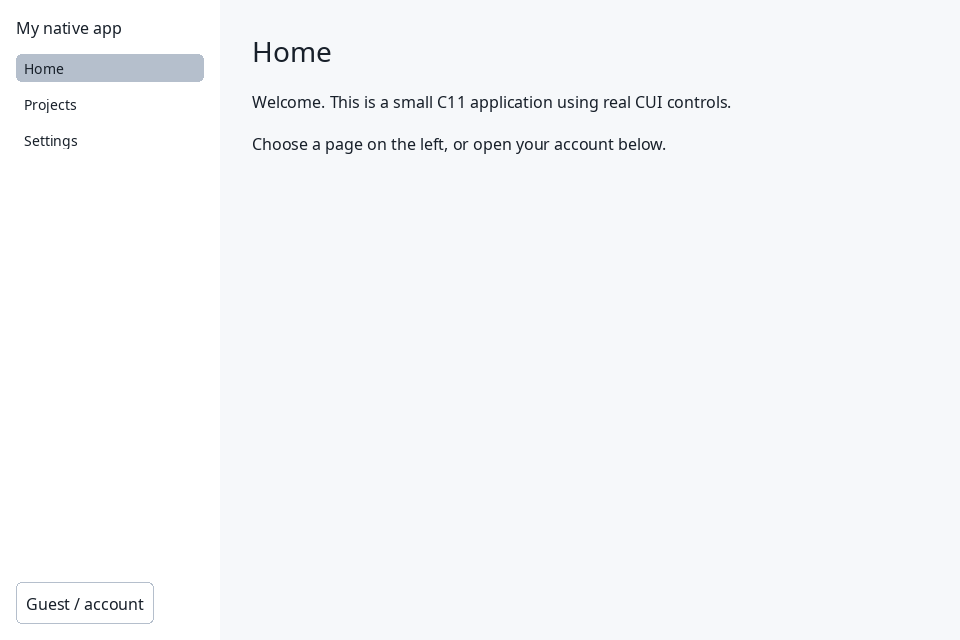
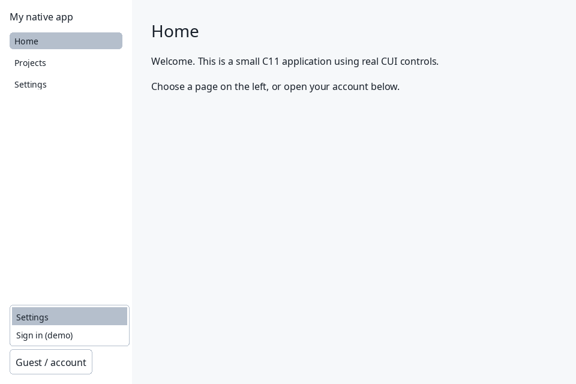
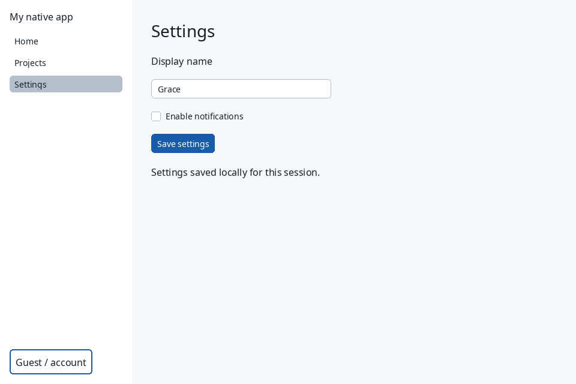

# Build your first native CUI app

The versioned alpha.6 starter includes the minimal app, fonts and CUI sources. [GitHub release archive](https://github.com/mattmezza/cui/releases/download/v0.1.0-alpha.6/cui-0.1.0-alpha.6-native-starter.tar.gz)

For the smallest standalone build, use the **native source bundle**.
[Download the archive](https://matteo.merola.co/cui/downloads/cui-native.tar.gz)
and its [SHA-256 checksum](https://matteo.merola.co/cui/downloads/cui-native.tar.gz.sha256). Given a C11
compiler, GNU Make, `ar`, pkg-config, SDL3 >= 3.2, FreeType and HarfBuzz development
packages, unpack it and run:

```sh
tar -xzf cui-native.tar.gz
cd cui-native
make
./build/native_starter
```

This path includes CUI's portable sources, native SDL3 adapter, text/bidi
implementation, generated assets, and Inter 4.1 Regular/Bold fonts with licenses.
It requires no installed CUI package or repository checkout. The default renderer
is SDL3's `SDL_Renderer`; Sokol and SDL_GPU are separate optional integrations.
Linux X11 is the validated native target; Windows, macOS and Wayland native
runtime support remains unverified. External system libraries remain prerequisites. See [macOS native builds and bundles](MACOS.md) and [Linux-to-macOS cross compilation](MACOS_CROSS.md) for the new workflows and their validation limits.

Before building, check their visibility:

```sh
cc --version
make --version
ar --version
pkg-config --atleast-version=3.2 sdl3
pkg-config --modversion sdl3 freetype2 harfbuzz
```

The archive's README explains the dependency layers and font policy. Ordinary
application edits compile only app objects and relink; compiler-generated header
dependencies trigger the appropriate CUI recompilation when headers change.
`make` never acquires dependencies. To produce the archive from this checkout,
run `make native-dist` (Python 3.9+ for this workflow), which writes `build/cui-native.tar.gz`.
The shared `cmake/sources.json` drives CMake, the portable header generator and
native source selection. Native packaging tests generate twice, compare bytes,
unpack outside the repository, verify checksums, build, check incremental rebuilds
and render a bounded Xvfb capture through `scripts/test_local.py`.

## Edit the two-file bundle app

The archive's `main.c` is the host: it loads both font faces, creates the context,
polls input, begins/ends each frame, renders and cleans up. `app.c` is the portable
UI: `app_frame` submits boxes, text and the button. Its `bool *clicked` points to
state owned by the host across frames. Change the greeting or button in `app.c`,
then run `make`; only that application object and executable rebuild.

```sh
make APP_SOURCES="main.c app.c" TARGET=build/my_app
./build/my_app
```

Add new relative `.c` paths to `APP_SOURCES`. Keep the executable directly in
`build/` for automatic font discovery, or provide both font paths explicitly.
The [bundle README](../examples/native_bundle/README.md) is the canonical consumer
build contract. Read [Layout](LAYOUT_GUIDE.md), [IDs and lifetimes](IDS_AND_LIFETIMES.md)
and [Debugging](DEBUGGING.md) before growing the application.

The source bundle built from current working source also includes the three-page
starter under `responsive/`. From that extracted bundle:

```sh
make APP_SOURCES="responsive/main.c responsive/app.c" TARGET=build/responsive_starter
./build/responsive_starter --font assets/fonts/Inter-Regular.otf
```

For an installed-library development workflow, build the same example as
described below.

The [C11 starter](../examples/native_starter/README.md) has Home, Projects and
Settings. A sidebar or compact navigation drawer selects the page and keeps
the account menu at the bottom. The current source includes a Projects workspace
with an adjustable split and tabs. Settings edits a name, toggles notifications
and saves local state. Sign-in and sign-out change demo state.



## Prerequisites

Use a C11 compiler (GCC, Clang or another conforming compiler), CMake 3.20 or
newer, Ninja, pkg-config, SDL3 **3.2 or newer**, FreeType and HarfBuzz development
packages, and a readable `.ttf` or `.otf` font. The Make path additionally needs
Make. Building CUI itself also needs Python 3; its optional C++ ABI example can
be disabled as below, so this path only requires a C compiler. SDL2 is not interchangeable with SDL3. A desktop display/session is needed
to open a window; Xvfb can provide an automated Linux test display.

The commands below assume those tools and libraries are already installed. Check
what pkg-config sees before building:

```sh
cc --version
cmake --version
ninja --version
pkg-config --atleast-version=3.2 sdl3
pkg-config --modversion sdl3 freetype2 harfbuzz
```

## Get the source

```sh
git clone https://github.com/mattmezza/cui.git
cd cui
```

## Build CUI, then the app

From the CUI repository root, install into a directory owned by your user:

```sh
cmake -S . -B build -G Ninja -DCUI_BUILD_NATIVE=ON \
  -DCMAKE_C_COMPILER=cc -DCUI_BUILD_CPP_EXAMPLE=OFF \
  -DCMAKE_INSTALL_PREFIX="$PWD/build/prefix"
cmake --build build
cmake --install build
export PKG_CONFIG_PATH="$PWD/build/prefix/lib/pkgconfig${PKG_CONFIG_PATH:+:$PKG_CONFIG_PATH}"
pkg-config --exists cui-sdl3
cmake -S examples/native_starter -B build/starter -G Ninja
cmake --build build/starter
python scripts/test_local.py --build-dir build/starter
./build/starter/native_starter --font /absolute/path/to/your/font.ttf
```

For example, this machine uses `/usr/share/fonts/noto/NotoSans-Regular.ttf`.
Choose a font that exists on your machine; CUI does not discover an OS font by
family name. If `cui-sdl3` is missing, inspect CUI's CMake output and confirm the
SDL3/FreeType/HarfBuzz development packages are visible through pkg-config.

The starter opens one regular face. CUI does **not** synthesize bold, semibold or
italic. Register the matching files before measuring or drawing styled text;
otherwise an unavailable style falls back to the regular face:

```c
/* font is the regular face returned by cui_font_open. Check both results. */
bool bold_ok = cui_font_register_style(font,
    (cui_text_style){.weight = CUI_TEXT_WEIGHT_BOLD}, "/path/to/NotoSans-Bold.ttf");
bool semibold_ok = cui_font_register_style(font,
    (cui_text_style){.weight = CUI_TEXT_WEIGHT_SEMIBOLD}, "/path/to/NotoSans-SemiBold.ttf");
if (!bold_ok || !semibold_ok) { /* report missing assets to your host */ }
```

Ship these faces with your app or supply explicit paths; filenames vary between
font families and installations. For a single-executable distribution, compile
font bytes into static arrays and open them with `cui_font_open_memory` instead.
See [embedding fonts](TEXT.md#embed-fonts-in-a-native-executable) for a complete
header-generation example, buffer lifetime rules, and style/fallback registration.

The example's CMake project consumes **installed** packages and does not build
the repository as a subdirectory. You can copy the whole `native_starter` folder
elsewhere and run `cmake -S /path/to/copied/folder -B /path/to/app-build -G Ninja`
with the same `PKG_CONFIG_PATH`.

## Make or a direct compiler command

With the same installed prefix exported above:

```sh
make -C examples/native_starter
make -C examples/native_starter test
./examples/native_starter/build/native_starter --font /absolute/path/to/your/font.ttf
```

Or, from the example directory, compile the two app sources directly:

```sh
cc -std=c11 -Wall -Wextra -Wpedantic \
  $(pkg-config --cflags cui-sdl3) main.c app.c \
  $(pkg-config --static --libs cui-sdl3) -o native_starter
./native_starter --font /absolute/path/to/your/font.ttf
```

Choose Clang with `-DCMAKE_C_COMPILER=clang` when configuring a fresh CUI build
and `CC=clang` for Make; `cc` normally selects your system compiler. CMake uses
C11 without compiler extensions.

Keep libraries **after** source/object files. CUI installs static archives, so use
`--static`: it includes private adapter/font dependencies. In the tested prefix,
the output included `-lcui_sdl3 -lcui_text -lcui -lm`, `-lcui_bidi`, `-lSDL3`,
FreeType/HarfBuzz and their platform dependencies. Use pkg-config's actual output
rather than copying one machine's entire linker line. This includes `-lm` where
required. The CMake example likewise uses `CUI_STATIC_*` results.



## Where to change the app

Read [app.h](../examples/native_starter/app.h) for application state and stable
control IDs, then [app.c](../examples/native_starter/app.c) for layout and
callbacks. The current logical width chooses the navigation layout each frame.
At the default MD breakpoint of 768 logical pixels, `cui_sidebar` holds the
links in its scrolling body and the account menu in its fixed footer. Below
MD, a Menu button opens a left Sheet with the same links and a pinned account
footer. Escape dismisses the inner account menu first. Closing the drawer
returns focus to Menu.

The page, account session, and Settings edit model live in the application.
Changing width preserves these values. The compact view caps the name input at
its available width. On crossing the breakpoint, the app closes any navigation
overlay whose trigger is leaving the current layout. Sidebar focus moves to
Menu in compact mode. On widening, Menu focus moves to the current page link;
focus in the drawer moves to the matching sidebar link or account control.
The Settings input and Projects tabs keep their focus across layouts. The two
navigation layouts use different IDs, so a press belongs to the layout where
it started.
See [responsive containers](RESPONSIVE_LAYOUT.md).

## Build on the Projects workspace

Open **Projects** and select either project to switch the detail header.
At MD and wider, drag the divider between the list and details. Below MD,
the same panes stack and the divider moves vertically. Focus the divider
and use the arrow keys for its current axis. Each orientation keeps its
own pane sizes, while the selected project and tab share state across layouts.

Use Left and Right on a focused tab. At narrow pane widths, scroll the tab
strip with Shift-wheel or a horizontal touch swipe, or open **All tabs** to
select any tab. If resizing hides the overflow button, focus moves to the
selected tab. If the resize changes the split's axis, the starter cancels
any divider drag and moves divider focus to the new handle.

Use `project_workspace` as the starting point for your own panes. Keep the
`cui_resizable_state` and slots in app storage. The pane callbacks borrow their
arguments during submission. The detail callback uses the resized pane's width
to bound `cui_tabs`. The CUI IDs for project links and tabs stay the same across
layouts. [Starter source](../examples/native_starter/app.c)

The page uses an auto-measured Scrollable below the compact Menu button. Short
windows can scroll by wheel or touch. The starter uses the previous layout
bounds to reveal focused Projects and Settings controls vertically. It shows
the scrollbar when the page overflows and holds content width steady as the
bar comes and goes. A new page starts at the top.

Navigation uses `cui_sidebar_menu` activation callbacks. Settings uses
`cui_input_ex`, `cui_checkbox` and `cui_button`. Extend `changed()` with your
persistence or application services. [Native host and callbacks](../examples/native_starter/main.c).

`main.c` opens the font, installs styled measuring and font metrics, creates the
SDL3 host and Core context, then polls input, gets the logical window size,
submits the app, applies its cursor and renders. The clipboard interface is
passed into the text input. The SDL adapter starts native text input, forwards
composition/commit events and synchronizes the prior frame's caret rectangle on
poll; the input owns its preedit state. This uses the supported SDL adapter,
without asserting every OS IME has been tested. Rendering and all font/SDL
operations stay on the main thread. Destruction runs in reverse ownership order.

The starter uses `cui_sdl3_run` and the host's frame delta. The callback
submits the scene using the current logical window size whenever the host
requests a redraw, including during resize.

## Verify it

`test_app.c` exercises real Core/component reducers without opening a window:
navigation callbacks, bottom-account geometry, sign-in/out, menu settings,
Escape dismissal, touch navigation, text-model editing, notification changes
and save callbacks. It also checks body-only scrolling, pinned account controls,
clipped link hit testing and repeated breakpoint crossings with an open account
menu, held input and unsaved edits. At 148 logical pixels tall, it verifies that
wheel, touch and Tab can scroll the page and that Save still works. A separate
Linux test verifies intermediate rendered frames and retained input focus during
a burst of native resize requests.
[Linux live-resize evidence](LINUX_LIVE_RESIZE.md).
Run the app for a bounded native capture with:

```sh
./build/starter/native_starter --font /absolute/path/to/font.ttf \
  --frames 3 --capture build/starter/home.bmp
```

For Linux automation, configure the repository build with
`-DCUI_BUILD_NATIVE_STARTER=ON` and `-DCUI_TEST_FONT=/absolute/path/to/font.ttf`,
build `cui_native_starter`, and run its smoke through the private-display wrapper.

```sh
python scripts/test_local.py --build-dir build -R '^native_starter_callback_smoke$'
```

Historical starter validation (before the current usability additions) checked an actual local installation:
standalone CMake/CTest, Make with warnings treated as errors, the direct compiler
command, and a Core-only build of `app.c` plus `test_app.c` all passed. At that historical checkpoint, integrated repository
CTest passed 96/96, sanitizer checks 96/96 and portable WASI suites 80/80. An Xvfb SDL3 window exercised Projects navigation, bottom-menu
sign-in/out, Settings navigation, editing the name to Grace, disabling
notifications and saving; callbacks reported the resulting state. These checks
cover the starter, not every platform, font or IME.




For a daemon-style native host, create the window hidden from its first instant:

```c
cui_sdl3 *host = cui_sdl3_create_with_options("Notifications", 480, 320, font,
    (cui_sdl3_window_options){.initially_hidden = true});
/* Later, on the main thread: */
if (host) cui_sdl3_set_visible(host, true);
```

The option sets SDL's hidden flag in the window constructor; no visible window
is created and then hidden. Zero options and `cui_sdl3_create()` preserve visible
creation. `cui_sdl3_is_visible()` queries SDL's hidden flag; it does not establish
whether a window is occluded or minimized. Visibility operations are main-thread
only and the OS may map/unmap asynchronously. The old constructor ABI is
unchanged; the new options type does not extend any existing by-value structure.
Sokol and SDL_GPU adapters do not own windows: their host must request hidden
creation. Bridge and language builder native runners expose opt-in hidden creation
through independent window options; see [binding builders](BINDING_BUILDERS.md). Linux X11/private-Xvfb validation does not
establish Wayland, Windows or macOS behavior.
