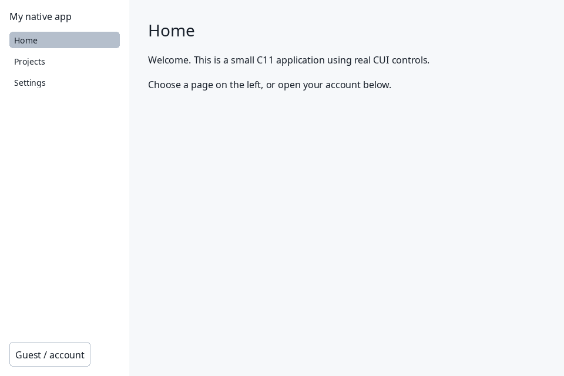
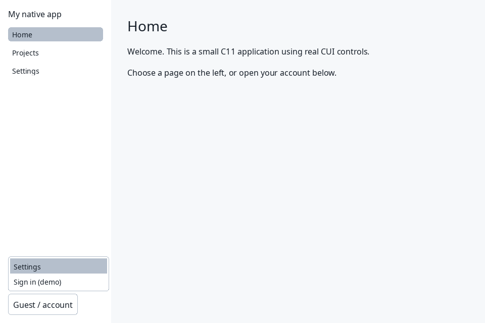
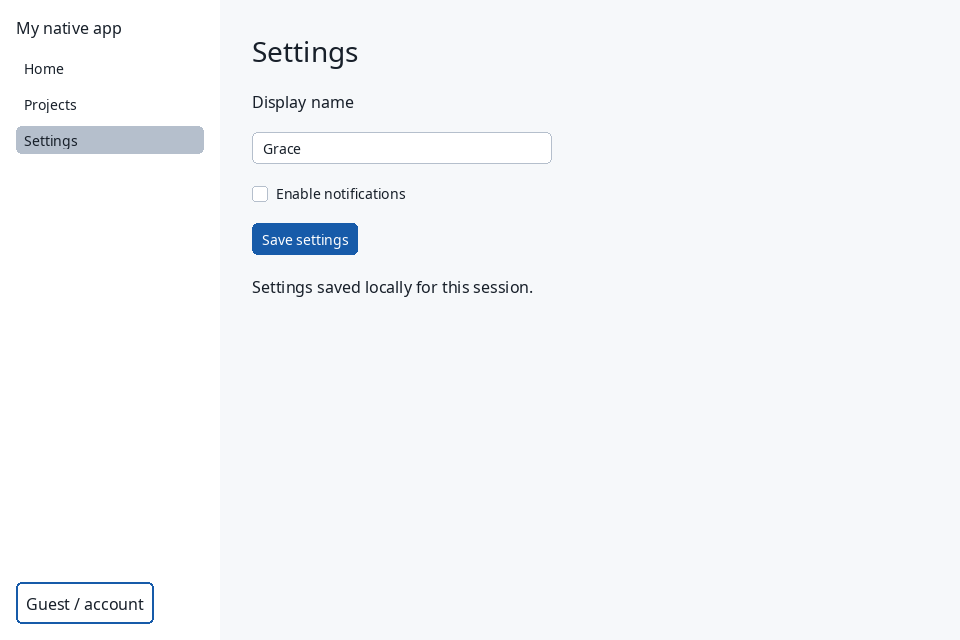

# Build your first native CUI app

For the smallest standalone build, use the **native source bundle**. Given a C11
compiler, GNU Make, `ar`, pkg-config, SDL3 >= 3.2, FreeType and HarfBuzz development
packages, unpack it and run:

```sh
tar -xzf cui-native.tar.gz
cd cui-native
make
./build/native_starter
```

This path includes CUI's portable sources, native SDL3 adapter, text/bidi
implementation, generated assets, and Inter 4.1 Regular/Bold fonts with licenses.
It requires no installed CUI package or repository checkout. The default renderer
is SDL3's `SDL_Renderer`; Sokol and SDL_GPU are separate optional integrations.
Linux X11 is the validated native target; Windows, macOS and Wayland native
runtime support remains unverified. External system libraries remain prerequisites.

Before building, check their visibility:

```sh
cc --version
make --version
ar --version
pkg-config --atleast-version=3.2 sdl3
pkg-config --modversion sdl3 freetype2 harfbuzz
```

The archive's README explains the dependency layers and font policy. Ordinary
application edits compile only app objects and relink; compiler-generated header
dependencies trigger the appropriate CUI recompilation when headers change.
`make` never acquires dependencies. To produce the archive from this checkout,
run `make native-dist` (Python 3.9+ for this workflow), which writes `build/cui-native.tar.gz`.
The shared `cmake/sources.json` drives CMake, the portable header generator and
native source selection. Native packaging tests generate twice, compare bytes,
unpack outside the repository, verify checksums, build, check incremental rebuilds
and render a bounded Xvfb capture through `scripts/test_local.py`.

## Edit the two-file bundle app

The archive's `main.c` is the host: it loads both font faces, creates the context,
polls input, begins/ends each frame, renders and cleans up. `app.c` is the portable
UI: `app_frame` submits boxes, text and the button. Its `bool *clicked` points to
state owned by the host across frames. Change the greeting or button in `app.c`,
then run `make`; only that application object and executable rebuild.

```sh
make APP_SOURCES="main.c app.c" TARGET=build/my_app
./build/my_app
```

Add new relative `.c` paths to `APP_SOURCES`. Keep the executable directly in
`build/` for automatic font discovery, or provide both font paths explicitly.
The [bundle README](../examples/native_bundle/README.md) is the canonical consumer
build contract. Read [Layout](LAYOUT_GUIDE.md), [IDs and lifetimes](IDS_AND_LIFETIMES.md)
and [Debugging](DEBUGGING.md) before growing the application.

The existing installed-library starter below remains useful for projects that
prefer an installed CUI package and a larger three-page example.

Start with [examples/native_starter](../examples/native_starter/README.md). It is
an ordinary C11 desktop app: a left sidebar selects Home, Projects and Settings;
an account menu stays at the sidebar bottom; Settings edits a name, toggles
notifications and saves local state. Sign-in/out is a demo state change, with no
credentials or network request.



## Prerequisites

Use a C11 compiler (GCC, Clang or another conforming compiler), CMake 3.20 or
newer, Ninja, pkg-config, SDL3 **3.2 or newer**, FreeType and HarfBuzz development
packages, and a readable `.ttf` or `.otf` font. The Make path additionally needs
Make. Building CUI itself also needs Python 3; its optional C++ ABI example can
be disabled as below, so this path only requires a C compiler. SDL2 is not interchangeable with SDL3. A desktop display/session is needed
to open a window; Xvfb can provide an automated Linux test display.

The commands below assume those tools and libraries are already installed. Check
what pkg-config sees before building:

```sh
cc --version
cmake --version
ninja --version
pkg-config --atleast-version=3.2 sdl3
pkg-config --modversion sdl3 freetype2 harfbuzz
```

## Get the source

```sh
git clone https://github.com/mattmezza/cui.git
cd cui
```

## Build CUI, then the app

From the CUI repository root, install into a directory owned by your user:

```sh
cmake -S . -B build -G Ninja -DCUI_BUILD_NATIVE=ON \
  -DCMAKE_C_COMPILER=cc -DCUI_BUILD_CPP_EXAMPLE=OFF \
  -DCMAKE_INSTALL_PREFIX="$PWD/build/prefix"
cmake --build build
cmake --install build
export PKG_CONFIG_PATH="$PWD/build/prefix/lib/pkgconfig${PKG_CONFIG_PATH:+:$PKG_CONFIG_PATH}"
pkg-config --exists cui-sdl3
cmake -S examples/native_starter -B build/starter -G Ninja
cmake --build build/starter
python scripts/test_local.py --build-dir build/starter
./build/starter/native_starter --font /absolute/path/to/your/font.ttf
```

For example, this machine uses `/usr/share/fonts/noto/NotoSans-Regular.ttf`.
Choose a font that exists on your machine; CUI does not discover an OS font by
family name. If `cui-sdl3` is missing, inspect CUI's CMake output and confirm the
SDL3/FreeType/HarfBuzz development packages are visible through pkg-config.

The starter opens one regular face. CUI does **not** synthesize bold, semibold or
italic. Register the matching files before measuring or drawing styled text;
otherwise an unavailable style falls back to the regular face:

```c
/* font is the regular face returned by cui_font_open. Check both results. */
bool bold_ok = cui_font_register_style(font,
    (cui_text_style){.weight = CUI_TEXT_WEIGHT_BOLD}, "/path/to/NotoSans-Bold.ttf");
bool semibold_ok = cui_font_register_style(font,
    (cui_text_style){.weight = CUI_TEXT_WEIGHT_SEMIBOLD}, "/path/to/NotoSans-SemiBold.ttf");
if (!bold_ok || !semibold_ok) { /* report missing assets to your host */ }
```

Ship these faces with your app or supply explicit paths; filenames vary between
font families and installations. See [Text](TEXT.md) for registration and fallback.

The example's CMake project consumes **installed** packages and does not build
the repository as a subdirectory. You can copy the whole `native_starter` folder
elsewhere and run `cmake -S /path/to/copied/folder -B /path/to/app-build -G Ninja`
with the same `PKG_CONFIG_PATH`.

## Make or a direct compiler command

With the same installed prefix exported above:

```sh
make -C examples/native_starter
make -C examples/native_starter test
./examples/native_starter/build/native_starter --font /absolute/path/to/your/font.ttf
```

Or, from the example directory, compile the two app sources directly:

```sh
cc -std=c11 -Wall -Wextra -Wpedantic \
  $(pkg-config --cflags cui-sdl3) main.c app.c \
  $(pkg-config --static --libs cui-sdl3) -o native_starter
./native_starter --font /absolute/path/to/your/font.ttf
```

Choose Clang with `-DCMAKE_C_COMPILER=clang` when configuring a fresh CUI build
and `CC=clang` for Make; `cc` normally selects your system compiler. CMake uses
C11 without compiler extensions.

Keep libraries **after** source/object files. CUI installs static archives, so use
`--static`: it includes private adapter/font dependencies. In the tested prefix,
the output included `-lcui_sdl3 -lcui_text -lcui -lm`, `-lcui_bidi`, `-lSDL3`,
FreeType/HarfBuzz and their platform dependencies. Use pkg-config's actual output
rather than copying one machine's entire linker line. This includes `-lm` where
required. The CMake example likewise uses `CUI_STATIC_*` results.



## Where to change the app

Read [app.h](../examples/native_starter/app.h) for the small application state and
stable control IDs, then [app.c](../examples/native_starter/app.c) for layout and
callbacks. Each frame submits the current page. The sidebar uses actual
`cui_sidebar_menu` activation callbacks; the account popup uses `cui_menu` with
an above-trigger anchor. A growing spacer places its trigger at the bottom.
Settings uses `cui_input_ex`, `cui_checkbox` and `cui_button`. `changed()` in
[main.c](../examples/native_starter/main.c) is a concrete callback seam for your
persistence or application services. State currently lasts only until exit.

`main.c` opens the font, installs styled measuring and font metrics, creates the
SDL3 host and Core context, then polls input, gets the logical window size,
submits the app, applies its cursor and renders. The clipboard interface is
passed into the text input. The SDL adapter starts native text input, forwards
composition/commit events and synchronizes the prior frame's caret rectangle on
poll; the input owns its preedit state. This uses the supported SDL adapter,
without asserting every OS IME has been tested. Rendering and all font/SDL
operations stay on the main thread. Destruction runs in reverse ownership order.

The loop uses a simple 16 ms step to keep the starter readable. A production app
can use an actual clock delta, persist state, add scrollable content and responsive
navigation, and supply fonts covering its text. The fixed 220 px sidebar targets
desktop-sized windows; this starter does not implement mobile navigation.

## Verify it

`test_app.c` exercises real Core/component reducers without opening a window:
navigation callbacks, bottom-account geometry, sign-in/out, menu settings,
Escape dismissal, text-model editing, notification changes and save callbacks.
Run the app for a bounded native capture with:

```sh
./build/starter/native_starter --font /absolute/path/to/font.ttf \
  --frames 3 --capture build/starter/home.bmp
```

Linux automation can prefix that command with
`xvfb-run -a -s "-screen 0 1600x1000x24" env SDL_VIDEODRIVER=x11 SDL_RENDER_DRIVER=software`.
Use a screen at least as large as the app window for coordinate-based interaction.
The screenshot above is from the actual SDL3 window, not a browser mockup.

The starter was checked against an actual local installation of this revision:
standalone CMake/CTest, Make with warnings treated as errors, the direct compiler
command, and a Core-only build of `app.c` plus `test_app.c` all passed. Integrated repository
CTest passed 96/96, sanitizer checks 96/96 and portable WASI suites 80/80. An Xvfb SDL3 window exercised Projects navigation, bottom-menu
sign-in/out, Settings navigation, editing the name to Grace, disabling
notifications and saving; callbacks reported the resulting state. These checks
cover the starter, not every platform, font or IME.


