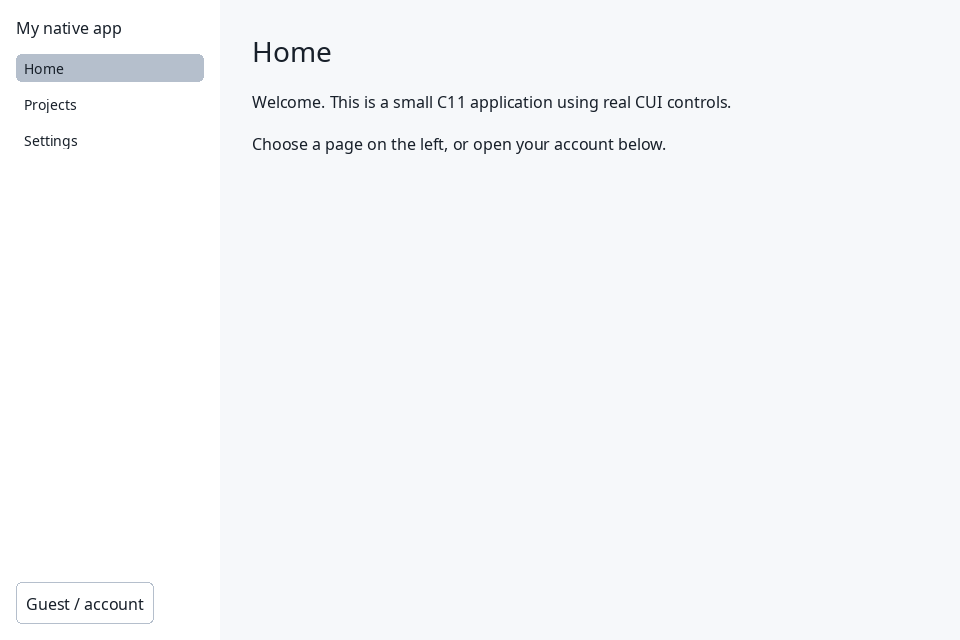

# Native CUI starter

A small C11 app with Home, Projects and Settings, real navigation callbacks,
and editable local settings. At 768 logical pixels and wider, the account menu
sits at the sidebar bottom. Below 768, **Menu** opens a drawer with the same
pages and account actions. Crossing the breakpoint preserves page and edit
state. Navigation focus moves to the corresponding visible control. In short
windows the page scrolls separately while the compact Menu stays pinned.

**Projects** combines a resizable list and detail pane with bounded tabs.
Drag the divider or focus it and use the arrow keys. Below 768, the panes
stack and keep a separate divider position. Scroll a narrow tab strip with
Shift-wheel or a touch swipe, or choose a tab from **All tabs**.

Follow [Build your first native CUI app](../../docs/NATIVE_APP_STARTER.md) for
prerequisites, installation, CMake, Make and direct compiler commands. The build
consumes an installed `cui-sdl3` pkg-config package; set `PKG_CONFIG_PATH` to its
prefix. Copy this folder to start a separate project.

- `app.h` defines persistent state, callbacks and stable IDs.
- `app.c` submits components and applies actions.
- `main.c` manages the native font, window, input, clipboard and render loop.
- `test_app.c` verifies navigation, scrolling, divider drag, tab selection and
  focus across resizes without a native window.

Sign-in/out is local demonstration state; no authentication service is connected.

On macOS the CMake starter produces `native_starter.app`, including the pinned
Inter fonts and their license. Finder launches discover the bundled font; `--font`
still overrides it. Set `CUI_MACOS_BUNDLE=OFF` for a plain executable.

A copied starter must set `-DCUI_MACOS_BUNDLE_HELPER=/path/to/CUIMacOSBundle.cmake`
and `-DCUI_MACOS_FONT_DIR=/path/to/third_party/inter` from the same CUI checkout.
Native macOS installs deploy linked dylibs through CMake BundleUtilities by default;
set `CUI_MACOS_DEPLOY_DEPENDENCIES=OFF` to manage deployment yourself.
Cross builds require a Darwin toolchain, SDK and target dependencies. They package
resources without executing target binaries. Dependency deployment is disabled:
stage target dylibs, repair install names, and sign/notarize on macOS separately.

Keep `CUISignMacOS.cmake` beside the bundle helper when copying the helpers; native dependency deployment applies ad-hoc development signatures after fixing library paths.
